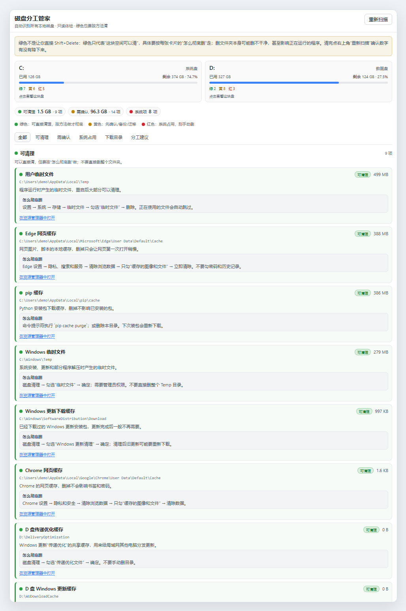
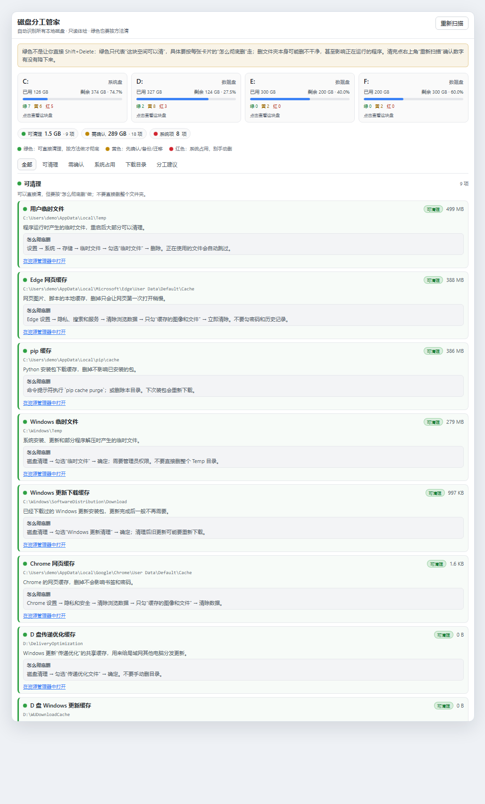
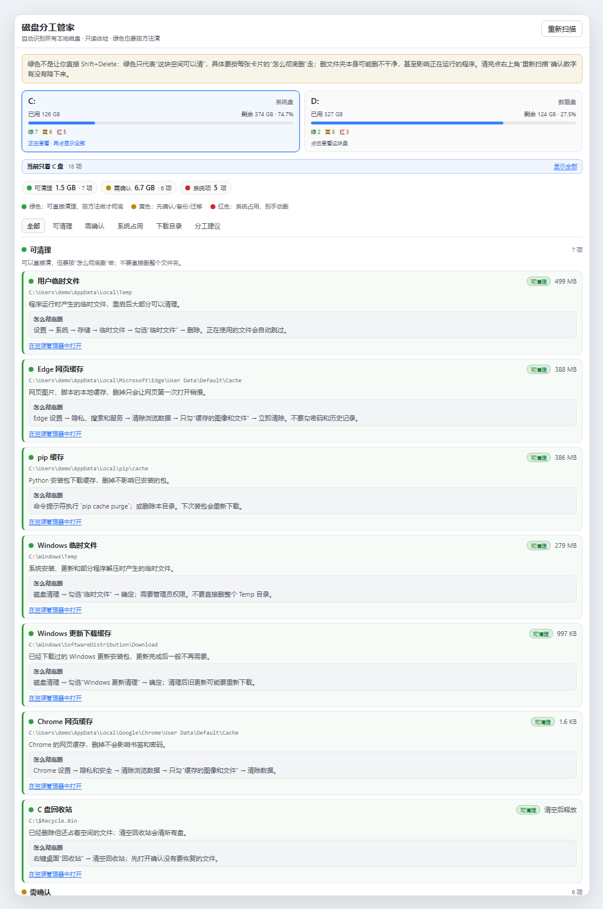
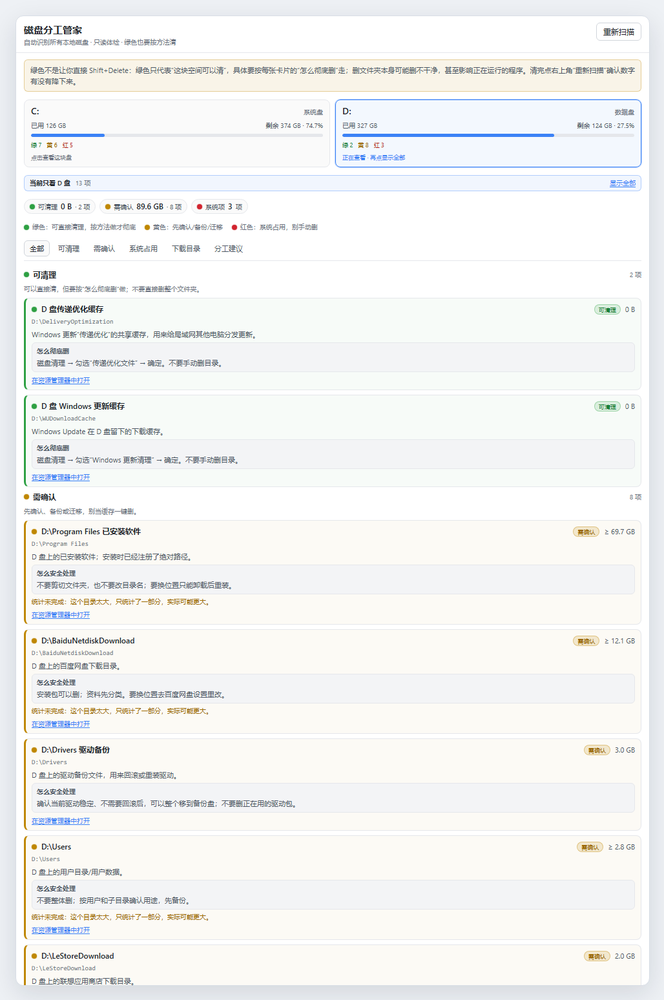
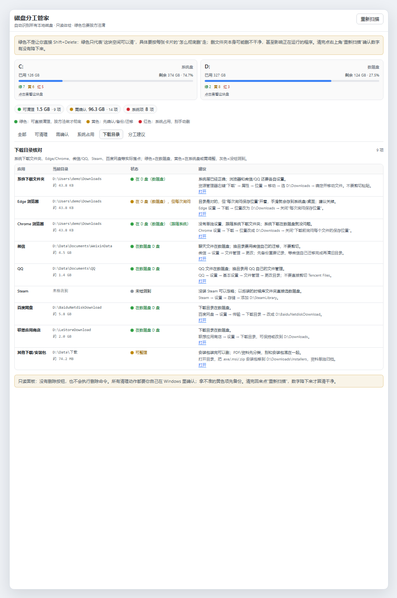
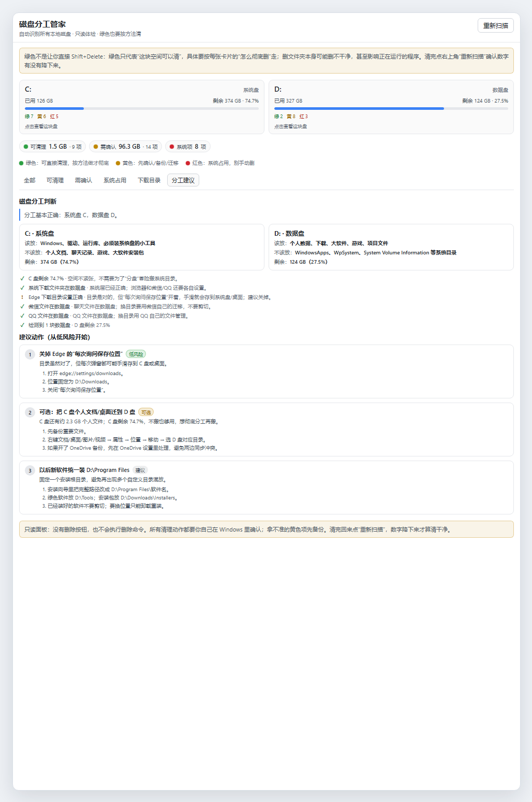

# 磁盘分工管家 · DSH Drive Manager

一个 [DeepSeek Harness](https://github.com/deepseek-ai) 的只读磁盘面板：自动识别 **C/D/E/F… 所有固定盘**，按 **绿 / 黄 / 红** 分类磁盘空间，核对下载目录，并给出多盘分工与迁移建议。

> 只读：没有删除按钮，也不会执行删除命令。绿色项也会明确告诉你“怎么彻底删”，避免只删一半或删错。



## 功能

- **自动识别多块盘**：C、D、E、F…… 不需要配置盘符；左侧栏打开后自动扫描。
- **点击盘卡片过滤**：点 C 只看 C，点 D 只看 D；再点一次或“显示全部”恢复。
- **绿 / 黄 / 红三色**：
  - 绿色：可以直接清理的缓存/临时文件，附“怎么彻底删”（磁盘清理、浏览器清缓存、`pip cache purge`、清空回收站等）。
  - 黄色：个人数据、已安装软件、聊天记录、项目文件、自定义目录；附“怎么安全处理”，提醒先备份/迁移/卸载重装。
  - 红色：Windows、Program Files、ProgramData、还原点、商店应用、虚拟内存等系统占用；说明为什么不能手动删。
- **下载目录核对**：系统下载文件夹、Edge、Chrome、微信、QQ、Steam、百度网盘、联想商店、其他安装包；绿色=在数据盘，黄色=在系统盘或需调整，灰色=没检测到。
- **分工建议**：系统盘/数据盘角色判断、检查项、按风险排序的迁移步骤。
- **自定义目录发现**：每块数据盘顶层未识别的目录会标黄列出（不递归统计体积），方便发现 `D:\Data`、`E:\Projects` 这类自定义目录。

## 多盘自动识别



截图用 C/D/E/F 四块盘演示：每块盘都会有自己的容量卡和绿/黄/红计数，点卡片即可只看这一块盘。E/F 等盘不需要配置，接上就会被识别。

## 只看某一块盘





## 下载目录核对



## 分工建议



## 颜色含义

| 颜色 | 含义 | 面板里给什么 |
|---|---|---|
| 绿色 | 可以清理的缓存/临时文件 | “怎么彻底删”：系统/软件自带清理方式，避免只删一半 |
| 黄色 | 用户数据、已安装软件、聊天记录、项目文件 | “怎么安全处理”：备份、迁移、卸载重装 |
| 红色 | 系统/商店应用/还原点/虚拟内存 | “为什么不能删”：用系统工具或卸载器 |

## 安装

要求：Windows 10/11，DSH `>= 0.2.1-rc.2`。

### 从 GitHub 安装

```powershell
dsh plugin --profile desktop add github:JKL-3484/-
```

> 仓库名就是一个 `-`。如果 DSH 的 `github:` 解析不了这个特殊名字，可以改用完整地址：
>
> ```powershell
> dsh plugin --profile desktop add https://github.com/JKL-3484/-
> ```
>
> 或者用下面的 clone + link 方式。

### 本地开发安装

```powershell
git clone https://github.com/JKL-3484/-.git
dsh plugin --profile desktop add link:<仓库绝对路径>
```

安装/更新后**完全退出 DSH（含托盘）再启动**，左侧栏出现硬盘图标「磁盘分工管家」。

## 使用

1. 点左侧栏硬盘图标。
2. 第一次扫描约 10–20 秒（大目录会标 `≥`，表示只统计了一部分）。
3. 点盘卡片过滤；点“在资源管理器中打开”跳转到对应目录。
4. 按绿色卡片的“怎么彻底删”清理；清完点右上角“重新扫描”确认数字降下来。

## 安全边界

- **只读**：没有删除接口，也不执行删除命令；只有“在资源管理器中打开”。
- 大目录按时间预算统计，显示 `≥` 表示只算了一部分；`Windows`、`WindowsApps`、`WpSystem`、还原点等系统目录不统计。
- 自定义顶层目录只列名称、不递归统计体积，避免长时间扫盘。
- 清理动作需要用户自己在 Windows 里确认；黄色项请先备份。

## 数据来源

- 盘符/容量/卷标：`Get-CimInstance Win32_LogicalDisk`（失败时回退 `fs.statfs`）
- 系统下载：`HKCU\...\User Shell Folders` 的 `{374DE290-...}`
- Edge/Chrome：`Preferences` 的 `download.default_directory` / `prompt_for_download`
- 微信/QQ：常见路径 + 数据盘浅层目录发现
- Steam：`HKCU\Software\Valve\Steam\SteamPath` 和 `libraryfolders.vdf`
- 百度网盘/联想商店：各盘常见下载目录
- 空间统计：Node `fs` 递归统计（带时间预算，跳过符号链接）

## 开发

```powershell
# 语法检查
node --check plugin/index.js
node --check plugin/client.js

# 安装到 desktop profile（开发用 link）
dsh plugin --profile desktop add link:<仓库绝对路径>
```

面板接口：

- `GET /api/drive-manager/overview`
- `POST /api/drive-manager/scan`
- `POST /api/drive-manager/reveal`（`{ "path": "D:\\..." }`）

## 已知限制

- 仅 Windows。
- 首次扫描时间取决于磁盘数量和目录大小。
- 自定义目录不递归统计体积。
- 部分系统目录没有权限统计，会标“受系统保护，不统计”。

## License

MIT
